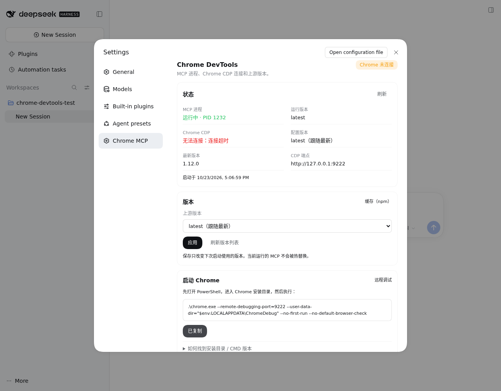

# @lolkda/dsh-chrome-devtools-mcp

把官方 [`chrome-devtools-mcp`](https://github.com/ChromeDevTools/chrome-devtools-mcp) 封装成 DeepSeek Harness 的 profile bundle，并在设置页提供状态、版本切换和 SSH 隧道命令。

## 功能



- 设置弹窗左侧导航新增“Chrome MCP”。
- 显示 MCP 进程、Chrome CDP 连通性、配置版本、运行版本和最新版本。
- 在 `latest` 与 GitHub Releases 的稳定版本之间切换。
- 版本选择保存到 `$DSH_HOME/dsh-chrome-devtools-mcp/state.json`，重启 DSH 后生效。
- 生成并复制 Chrome 远程调试启动命令。
- 生成并复制 SSH 反向隧道命令。
- 提供 Windows OpenSSH Client 与可选 OpenSSH Server 的安装、启用命令。

## 安装

```bash
dsh plugin --profile web add @lolkda/dsh-chrome-devtools-mcp@0.3.1
```

也可以从本地 tarball 安装：

```bash
dsh plugin --profile web add file:/path/to/lolkda-dsh-chrome-devtools-mcp-0.3.1.tgz
```

安装前请删除 profile 里手工写的 `chrome-devtools-mcp` 插入块，避免同一个 `id` 冲突。安装后重启 DSH。

## 版本策略

默认是 `latest`：

- launcher 每次启动时解析 `chrome-devtools-mcp@latest`。
- 上游发新版后，下次重启 DSH 自动使用新版。
- 在设置页选择固定版本后，launcher 使用 `chrome-devtools-mcp@x.y.z`。
- 切换版本需要重启 DSH，当前运行的 MCP 不会被热替换。

状态文件：

```text
$DSH_HOME/dsh-chrome-devtools-mcp/state.json
$DSH_HOME/dsh-chrome-devtools-mcp/runtime.json
$DSH_HOME/dsh-chrome-devtools-mcp/releases-cache.json
```

## 启动 Chrome

在 PowerShell 中先进入 Chrome 安装目录，再执行：

```powershell
.\chrome.exe --remote-debugging-port=9222 --user-data-dir="$env:LOCALAPPDATA\ChromeDebug" --no-first-run --no-default-browser-check
```

不知道安装目录时，在 Chrome 地址栏打开 `chrome://version`，查看“可执行文件路径”，然后 `cd` 到该目录。这样使用相对路径 `.\chrome.exe`，不依赖固定的安装位置。

CMD 版本：

```bat
.\chrome.exe --remote-debugging-port=9222 --user-data-dir=%LOCALAPPDATA%\ChromeDebug --no-first-run --no-default-browser-check
```

`--user-data-dir` 会创建一个独立的调试 profile，第一次需要重新登录网站。

## 连接 Chrome

> SSH 用户名是 **DSH 主机账号**，不是 Windows 登录用户。密码由 `ssh` 在运行时提示；不要把密码写进命令。

默认连接 DSH 主机回环地址：

```text
http://127.0.0.1:9222
```

如果 Chrome 在另一台 Windows 机器上，在 Windows PowerShell 中执行设置页生成的命令：

```powershell
ssh -N -o ServerAliveInterval=30 -o ExitOnForwardFailure=yes -R 9222:127.0.0.1:9222 <user>@192.168.1.100
```

Chrome 需要以远程调试方式启动，或通过 `chrome://inspect/#remote-debugging` 开启调试。

反向隧道只需要 Windows 的 OpenSSH Client。OpenSSH Server 是可选能力，只有需要从 DSH 主动 SSH 到 Windows 时才需要。

## CI 与发布

- `.github/workflows/ci.yml`：`main` push 和 PR 时运行测试与 `npm pack --dry-run`。
- `.github/workflows/publish.yml`：GitHub Release 发布时，通过 npm trusted publishing（OIDC）发布；也支持手动 `workflow_dispatch`，默认只做 dry run。

工作流不使用 `NPM_TOKEN`。npm 侧需要先把仓库配置为 trusted publisher。

在 npmjs.com 打开：

```text
Packages → @lolkda/dsh-chrome-devtools-mcp → Settings → Trusted publishing
```

填写：

```text
Provider: GitHub Actions
Repository: lolkda/dsh-chrome-devtools-mcp
Workflow filename: publish.yml
Environment: 留空
```

也可以用 npm 11.19.1+ 的 CLI：

```bash
npm login
npm trust github @lolkda/dsh-chrome-devtools-mcp \
  --file publish.yml \
  --repo lolkda/dsh-chrome-devtools-mcp \
  --allow-publish
```

新配置必须在 **2 天内完成首次成功发布**，否则会过期。

### 首次发布 bootstrap

如果 npm 上还没有这个包，最稳的顺序是先用本地 OAuth 登录发布一次，再配置 trusted publisher：

```bash
npm login
npm publish --access public --registry=https://registry.npmjs.org
```

`npm login` 会打开浏览器 OAuth 授权页，登录后本地会得到短期发布 token。

首次发布成功后，在 npmjs.com 配置：

```text
Packages → @lolkda/dsh-chrome-devtools-mcp → Settings → Trusted publishing
Provider: GitHub Actions
Repository: lolkda/dsh-chrome-devtools-mcp
Workflow filename: publish.yml
Environment: 留空
```

然后清掉本地 token：

```bash
npm logout
```

并在包设置里选择“Require 2FA and disallow tokens”。之后的版本通过 GitHub Release 和 OIDC 发布；`0.3.0` 已通过本地 token 发布；`0.3.1` 开始通过 OIDC 发布。工作流遇到已存在的版本会自动跳过。

发布 tag 必须与 `package.json` 的版本一致，例如：

```bash
git tag v0.3.1
git push origin v0.3.1
```

然后在 GitHub 创建 Release，工作流会执行测试并发布到 npm。

## 开发

```bash
npm install
npm test
npm pack
```

规格见 [docs/specs/chrome-devtools-settings.md](docs/specs/chrome-devtools-settings.md)。

## 许可

本包代码使用 MIT。`chrome-devtools-mcp` 由 Google LLC 维护，使用 Apache-2.0，见其[仓库](https://github.com/ChromeDevTools/chrome-devtools-mcp)。
